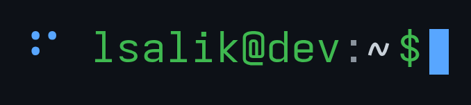

  
  
  
  
  
  
  
   
  
  
  
  
  
  

  
  
  &nbsp;
  
  
  
  

<pre>
lsalik@dev:~$ whoami
luis salik, aerospace &amp; software engineer

lsalik@dev:~$ ls ~/focus
machine-learning/  control-systems/  data-science/  manufacturing/

lsalik@dev:~$ echo $LOCATION
greater chicago area

lsalik@dev:~$ tail -n 3 ~/blog<!-- latest-posts:start -->
2026-10-14  <a href="https://lsalik.dev/blog/bashcraft-a-bash-shell-for-minecraft/">BashCraft: a bash shell for Minecraft's command line</a>
2026-10-14  <a href="https://lsalik.dev/blog/fortunes-terminal-sized-curl-and-an-astro-7-outage/">Fortunes, terminal-sized curl, and an Astro 7 outage</a>
2026-10-09  <a href="https://lsalik.dev/blog/screensaver-and-friends/">A screensaver, an /ssh easter egg, and the rest of the roadmap</a>
<!-- latest-posts:end -->
lsalik@dev:~$ _
</pre>
